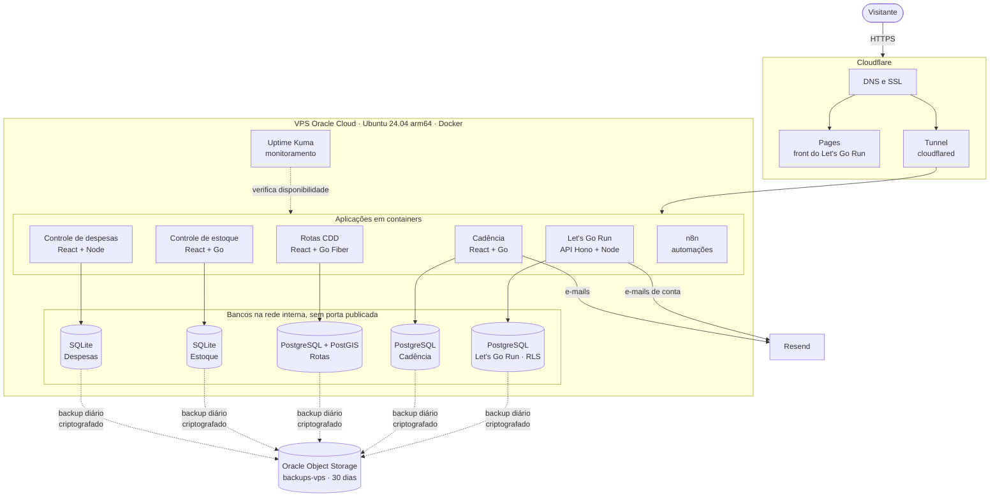

# Olá, eu sou o Saulo Rangel! 👋

## Desenvolvedor de software em formação

Estudante do 2º semestre de **Análise e Desenvolvimento de Sistemas (ADS)** na Estácio, com conclusão prevista para **julho de 2028**. Estou em transição de carreira para desenvolvimento e busco uma oportunidade de **estágio em tecnologia**.

Tenho **13 anos de experiência nos Correios**, em um contexto operacional e logístico. Essa trajetória fortaleceu minha organização, responsabilidade, análise de processos e capacidade de transformar necessidades reais em soluções práticas.

Hoje desenvolvo e mantenho aplicações full stack e participo de todo o ciclo: interface, API, banco de dados, autenticação, testes, containers, deploy e acompanhamento em produção. Tudo roda na minha própria infraestrutura, e eu respondo por ela.

---

## 🚀 Projetos em destaque

### 🏃 Let's Go Run — treino de corrida personalizado e seguro

Uma entrevista com triagem de saúde (**PAR-Q+**) leva a um plano montado por **regras baseadas em pesquisa científica**, ajustado dia a dia pelo sono, pela dor e pelo cansaço de cada pessoa. **Nenhuma IA gera treino:** cada número tem fonte rastreável.

- **Segurança de verdade:** dados de saúde protegidos por *Row-Level Security* no banco, CSP restritiva, senha com argon2id, exportação e exclusão de dados (LGPD).
- **Qualidade:** 619 testes automatizados (motor de regras, API com banco real e telas), CI no GitHub Actions, Lighthouse 100 em acessibilidade e SEO.
- **Em produção:** front no Cloudflare Pages, API em container na minha VPS, em português e inglês.

📁 [Ver repositório](https://github.com/Saulorangel87/App-de-corrida) · 🌐 [Acessar aplicação](https://letsgorun.devsaulo.com.br)

 

<table>
<tr>
<td width="50%" valign="top">
<h3>🚴 Cadência — Treinos de ciclismo</h3>

Aplicação full stack para planejamento e acompanhamento de treinos, com regras de negócio, autenticação, API REST e experiência PWA.

<a href="https://github.com/Saulorangel87/App-de-treino">📁 Ver repositório</a> <a href="https://cadencia.devsaulo.com.br/">🌐 Acessar aplicação</a>

</td>
<td width="50%" valign="top">
<h3>📦 Controle de Estoque</h3>

Aplicação full stack para cadastro de produtos, entradas e saídas, alertas de estoque baixo, dashboard e autenticação.

<a href="https://github.com/Saulorangel87/App-controle-de-estoque">📁 Ver repositório</a> <a href="https://estoque.devsaulo.com.br/">🌐 Acessar aplicação</a>

</td>
</tr>
<tr><td colspan="2"> </td></tr>
<tr>
<td width="50%" valign="top">
<h3>🗺️ Sistema de Rotas</h3>

Ferramenta aplicada a um contexto logístico real para digitalizar a consulta e a organização de rotas, conectando visualização geográfica, dados espaciais e fluxos operacionais.

<a href="https://cddcampos.devsaulo.com.br/">🔒 Demonstração com acesso controlado</a>

</td>
<td width="50%" valign="top">
<h3>💰 Controle de Despesas</h3>

Aplicação full stack para organização financeira pessoal, com autenticação, receitas e despesas, categorias, relatórios e interface PWA.

<a href="https://github.com/Saulorangel87/App-controle-financeiro">📁 Ver repositório</a> <a href="https://despesas.devsaulo.com.br/">🌐 Acessar aplicação</a>

</td>
</tr>
</table>

---

## ☁️ Infraestrutura

Todos os projetos acima rodam na mesma infraestrutura, que eu mesmo monto e mantenho:

- **Containers Docker** para cada serviço, em servidor Linux (ARM64) com **Docker Compose**. A API do Let's Go Run roda sem root, com sistema de arquivos somente leitura.
- **Cloudflare Tunnel** para expor os serviços, **Cloudflare Pages** para o front do Let's Go Run e SSL em todos os domínios.
- **Bancos privados:** PostgreSQL e SQLite só na rede interna do Docker, sem porta publicada na internet.
- **Backups diários dos bancos das cinco aplicações**, todos criptografados antes de sair da VPS e guardados em um único bucket do Oracle Object Storage (uma pasta por projeto, retenção de 30 dias e sem permissão de apagar pela VPS). A restauração foi testada em todos; no Cadência o teste é mensal e automatizado.
- **Monitoramento** de disponibilidade e tempo de resposta com **Uptime Kuma**, com os resultados ao vivo logo abaixo.
- **Entrega contínua de qualidade:** GitHub Actions com lint, tipos, testes, gitleaks e `pnpm audit`; Dependabot para dependências.

---

## 🧩 Competências técnicas

**Frontend:** React, TypeScript, JavaScript, Vite, Tailwind CSS, HTML5, CSS3, interfaces responsivas, acessibilidade e PWA  
**Backend:** Go, Node.js (Hono e Express), APIs REST, autenticação (sessões, JWT e argon2id) e validação com Zod  
**Dados:** PostgreSQL (incluindo Row-Level Security e PostGIS), SQLite, SQL e migrações versionadas  
**Qualidade e segurança:** Vitest, Playwright, testes de autorização entre usuários, CSP, LGPD e documentação técnica  
**Engenharia:** integração frontend/backend, regras de negócio, troubleshooting e leitura de fontes científicas para transformar em regras  
**Infra e ferramentas:** Docker, Docker Compose, Linux, Nginx, Cloudflare (Tunnel e Pages), GitHub Actions, Git e VS Code

---

## 🎓 Formação e trajetória

- **Análise e Desenvolvimento de Sistemas — Estácio** — 2º semestre; conclusão prevista para julho de 2028
- **Correios — Agente de Correios / Carteiro Motorizado** — desde 11/03/2013
- Em transição de carreira e em busca de estágio em desenvolvimento de software

---

## 🛠️ Tech stack

---

## 📡 Status das aplicações em tempo real

| Aplicação | Status | Tempo de resposta | Uptime (24h) |
| :--- | :---: | :---: | :---: |
| [**Let's Go Run**](https://letsgorun.devsaulo.com.br/) |  |  |  |
| [**Cadência**](https://cadencia.devsaulo.com.br/) |  |  |  |
| [**Controle de despesas**](https://despesas.devsaulo.com.br/) |  |  |  |
| [**Controle de estoque**](https://estoque.devsaulo.com.br/) |  |  |  |
| [**Rotas CDD Campos**](https://cddcampos.devsaulo.com.br/) |  |  |  |
| [**n8n Automações**](https://n8n.devsaulo.com.br/) |  |  |  |

---

## 📊 Estatísticas do GitHub

  

---

## 🎯 Objetivos de aprendizado

✅ React, TypeScript e desenvolvimento frontend  
✅ APIs REST e backend com Go e Node.js  
✅ PostgreSQL, PostGIS e SQLite  
✅ Docker, Linux, Nginx e deploy em VPS  
✅ Testes automatizados (Vitest e Playwright) e monitoramento de disponibilidade  
🔄 Segurança de APIs e arquitetura de aplicações  
🔄 Observabilidade (logs, métricas e alertas)

---

  

<b>Feito por Saulo Rangel 🚀</b> 
Transformando aprendizado em projetos reais. 
⭐ Se algum projeto chamou sua atenção, deixe uma estrela!

